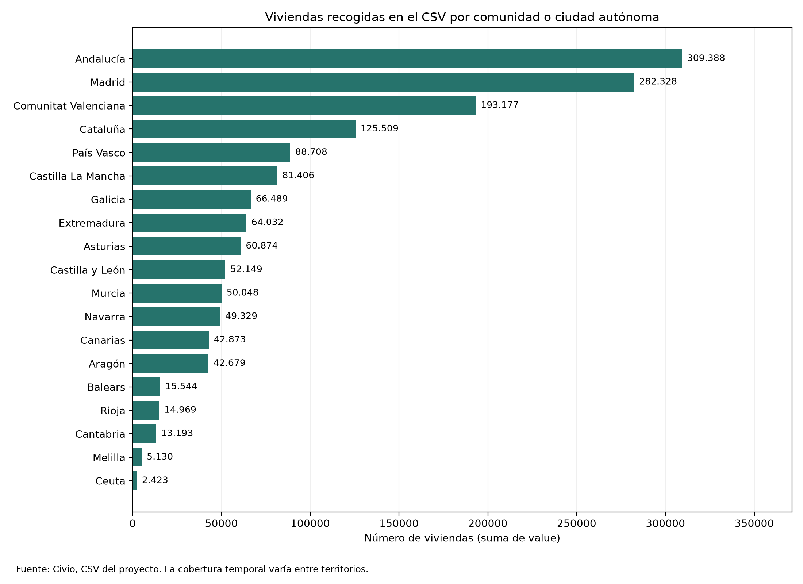

# Análisis exploratorio de la vivienda protegida en España

Proyecto desarrollado para el curso de Buenas prácticas en ciencia computacional con Python de la Universidad de Jaén.

## Participantes

- Ismael Majdoubi García.
- Ana Isabel Gallardo Cordovilla.
- 

## Descripción del dataset

El conjunto de datos contiene información sobre viviendas protegidas con calificación definitiva en España durante el periodo 1991-2025, recopilada por la Fundación Ciudadana Civio a partir de estadísticas oficiales y solicitudes de acceso a información pública.

**Fuente:** [Civio — Viviendas protegidas desde 1991 por comunidad autónoma](https://datos.civio.es/dataset/viviendas-protegidas-desde-1991-por-comunidad-autonoma/).

## Objetivos

- Explorar la estructura del conjunto de datos.
- Obtener estadísticas descriptivas de las variables.
- Identificar las categorías y valores más frecuentes.
- Representar gráficamente los resultados.

## Requisitos

Python, pandas y matplotlib.

## Ejecución

Instalar las dependencias:

`python -m pip install -r requirements.txt`

Ejecutar el análisis:

`python analisis.py`

Los resultados y las figuras se almacenan en las carpetas `resultados/` y `figuras/`, respectivamente.

## Estado del proyecto

Proyecto en desarrollo, pendiente de revisión colaborativa.

## Condiciones de uso de los datos

Los datos originales pertenecen a sus respectivas fuentes y han sido recopilados por Civio. Se respetan sus [condiciones de reutilización](https://datos.civio.es/condiciones-de-uso/).

## Análisis por comunidad autónoma

Aportación de Ana Isabel Gallardo Cordovilla.

El script `analisis_ccaa.py` agrupa los registros por comunidad o ciudad autónoma y suma la variable `value`, que contiene el número de viviendas de cada registro.

El archivo analizado contiene 9.769 registros y 11 variables. La suma de `value` es de 1.560.248 viviendas, distribuidas entre 19 territorios.

Los mayores totales del archivo corresponden a:

| Territorio | Viviendas | Porcentaje del total |
|---|---:|---:|
| Andalucía | 309.388 | 19,83 % |
| Madrid | 282.328 | 18,10 % |
| Comunitat Valenciana | 193.177 | 12,38 % |

La cobertura temporal varía entre territorios. Por ello, la tabla incluye el primer y último año de cada uno. Los totales describen las viviendas recogidas en el archivo durante sus respectivos periodos de cobertura.

Para ejecutar esta parte del análisis:

`python analisis_ccaa.py`

La tabla de resultados está disponible en
[resultados/resumen_ccaa.csv](resultados/resumen_ccaa.csv).

